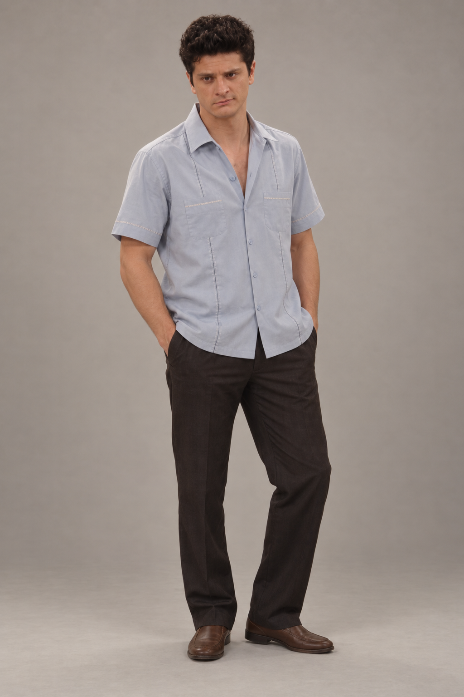
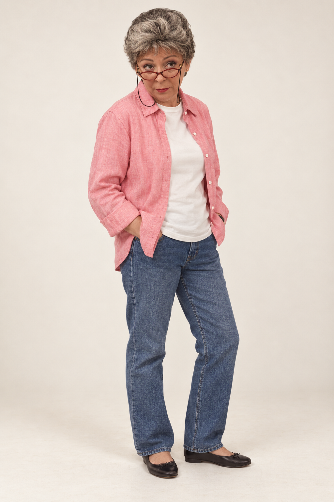
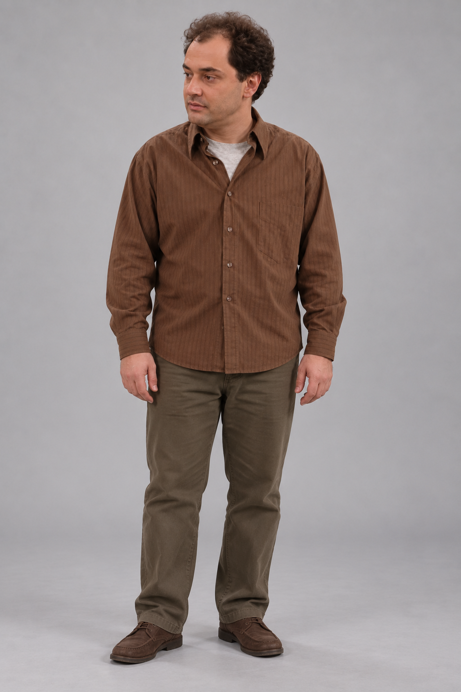
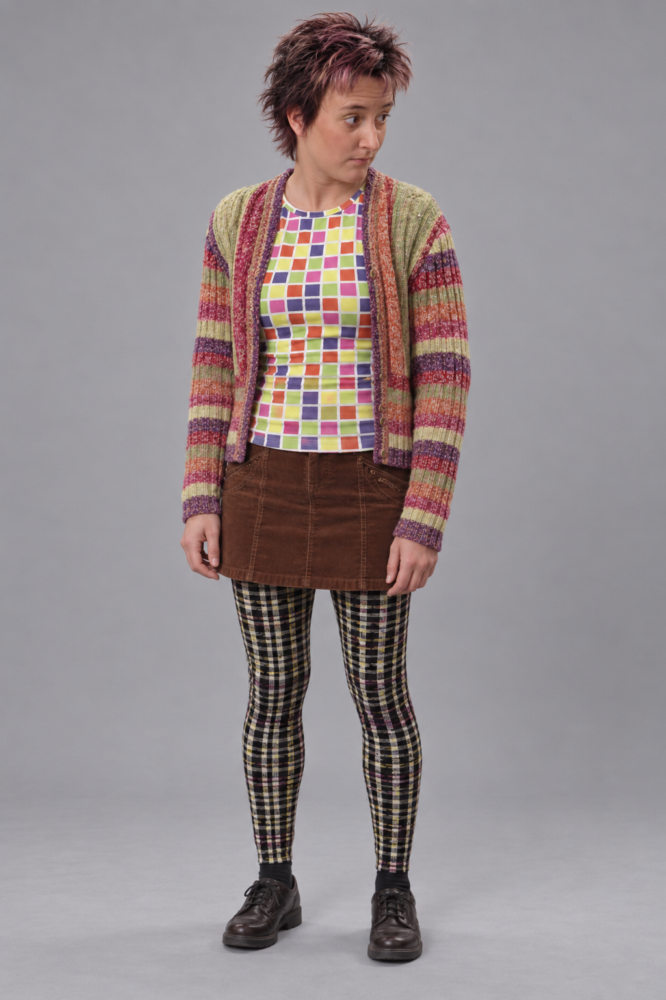
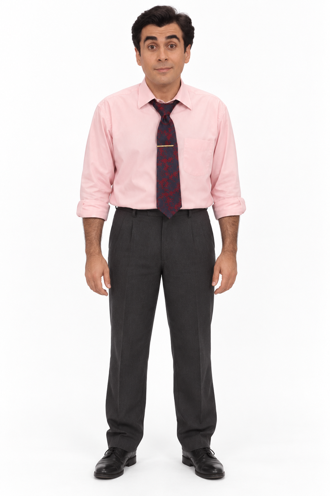

# Plats bruts amb Higgsfield

Com he fet ballar els personatges de *Plats bruts* amb imatges generades amb IA i Motion Transfer de Higgsfield. Aquí tens els vídeos, les imatges i els prompts per preparar les teves pròpies proves.

<table>
<tr>
<td align="center"> David</td>
<td align="center"> Carbonell</td>
<td align="center"> Lopes</td>
<td align="center"> Emma</td>
<td align="center"> Ramon</td>
</tr>
</table>

<strong><a href="docs/COM-FER-HO.md">Com fer-ho</a></strong> · <a href="imatges/README.md">Imatges dels personatges</a> · <a href="docs/PROCES.md">Com he preparat els vídeos</a>

## Imatges i vídeos

He fet servir la **skill `imagegen` de Codex**, que utilitza els models **GPT Image d'OpenAI**, per crear imatges que s'assemblen als personatges originals. Hi ha vistes de cos complet, retrats i perfils.

A Higgsfield he utilitzat les imatges amb prompts de Motion Transfer. He ajustat els retrats i els textos quan fallaven la semblança, el pentinat o la continuïtat dels personatges.

## Projectes

| Vídeo | Personatges | Original | Resultat publicat |
| --- | --- | --- | --- |
| [Toc Toc](projectes/01-toc-toc/README.md) | David, Carbonell, Lopes i Emma | [Original de TikTok](https://www.tiktok.com/@leopold.delarue01/video/7692704318167977239) | [7x01 · Tinc IA](https://www.tiktok.com/@barripbarrop/video/7692840194801798422) |
| [Alors on danse](projectes/02-alors-on-danse/README.md) | David i Lopes | [Original de TikTok](https://www.tiktok.com/@dany_stark1/video/7692922779645037845) | [7x02 · Tinc un prompt](https://www.tiktok.com/@barripbarrop/video/7693469196176411926) |
| [Smalltown Boy](projectes/03-smalltown-boy/README.md) | David i Lopes | [Original de TikTok](https://www.tiktok.com/@wdmowski/video/7693438653095333153) | [7x03 · Tinc tokens](https://www.tiktok.com/@barripbarrop/video/7693821703448808726) |
| [Toc Toc (David)](projectes/04-david-ball/README.md) | David | [Original de TikTok](https://www.tiktok.com/@realjeanpaul/video/7692287447505423646) | [7x04 · Tinc context](https://www.tiktok.com/@barripbarrop/video/7694237005521177878) |
| [Toc Toc (rave)](projectes/05-carbonell-rave/README.md) | Carbonell | [Original de TikTok](https://www.tiktok.com/@louulouutte/video/7691306720492064032) | [7x05 · Tinc un model frontera](https://www.tiktok.com/@barripbarrop/video/7694608044457544982) |
| [Une p'tite pipe, Hourra !](projectes/06-ramon/README.md) | Ramon | [Original de TikTok](https://www.tiktok.com/@jean.pamplemousse/video/7690909185839484193) | [7x06 · Tinc un reset](https://www.tiktok.com/@barripbarrop/video/7695837641186577686) |

## Què inclou el recull

- **21 imatges**, organitzades [per personatge](imatges/README.md).
- **Sis prompts de Motion Transfer**, un per vídeo, i dues versions anteriors d'Alors on danse.

Els vídeos utilitzats com a base de moviment no s'inclouen. Consulta els enllaços de cada projecte per veure els originals.

## Comença una prova

Tria un projecte, mira el resultat i segueix la [guia pas a pas](docs/COM-FER-HO.md). A cada fitxa trobaràs el prompt de Motion Transfer i els enllaços a les imatges que has de carregar. Si canvies de vídeo base, adapta el text a les persones i els moviments que hi apareixen.

Els prompts són en anglès i les guies, en català. Aquest és un projecte personal, sense vinculació oficial amb *Plats bruts*.
