# Imatges dels personatges

Tria les imatges del personatge que necessitis. Cada fitxa de vídeo indica quines has de carregar.

## David

<a href="david/david-perfil-mirant-avall.png">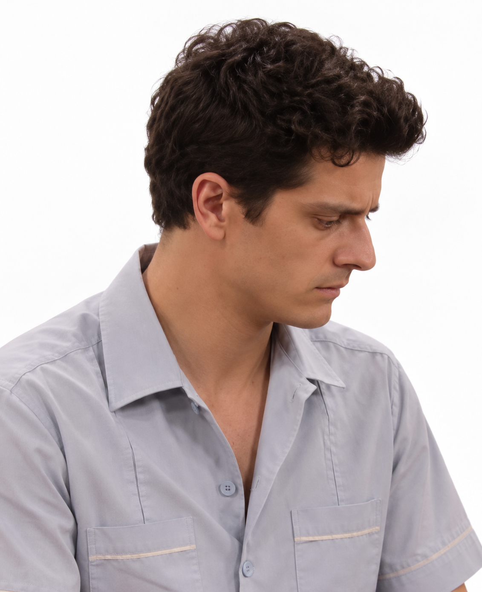</a>
<a href="david/david-perfil-nou-blanc.png">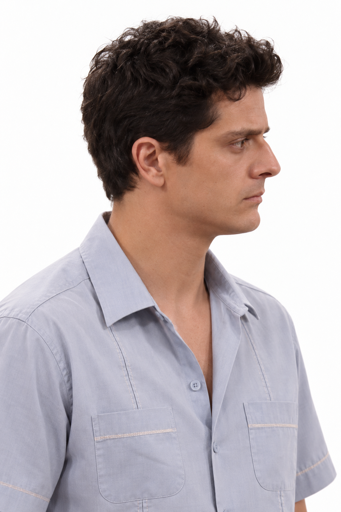</a>
<a href="david/david-retrat-nou-blanc.png">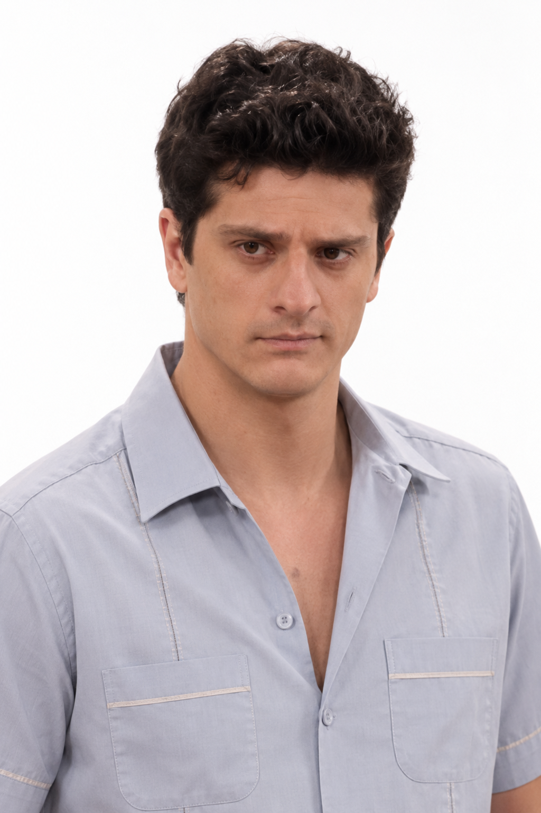</a>
<a href="david/david-retrat.png">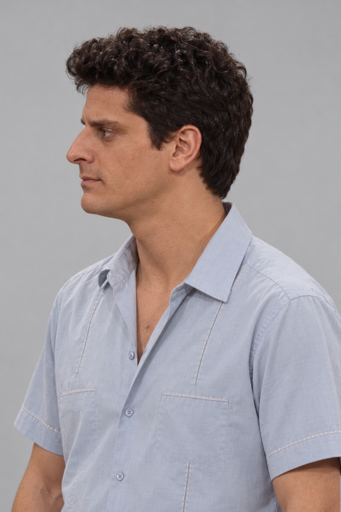</a>

## Lopes

<a href="lopes/lopes-cos-complet-nou.png">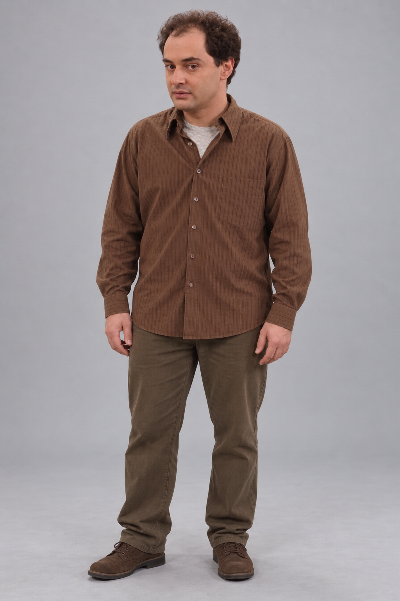</a>

<a href="lopes/lopes-perfil-nou-blanc.png">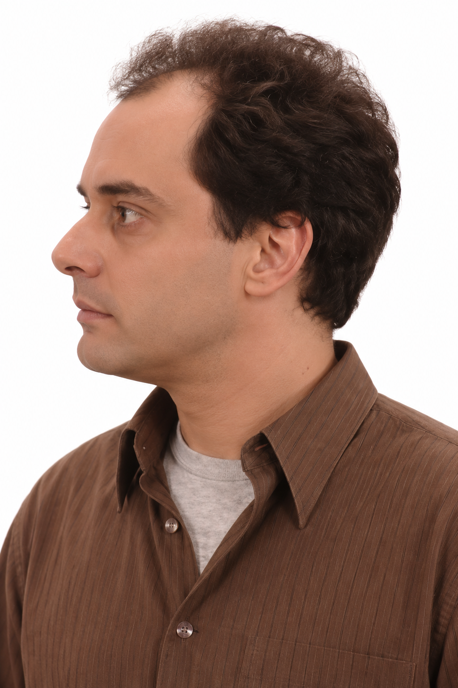</a>

<a href="lopes/lopes-retrat-nou.png">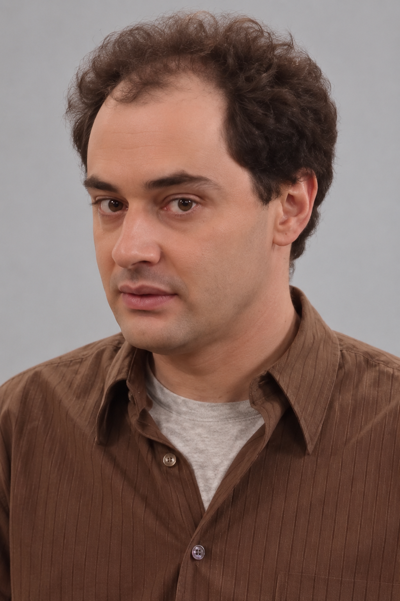</a>
<a href="lopes/lopes-retrat.png">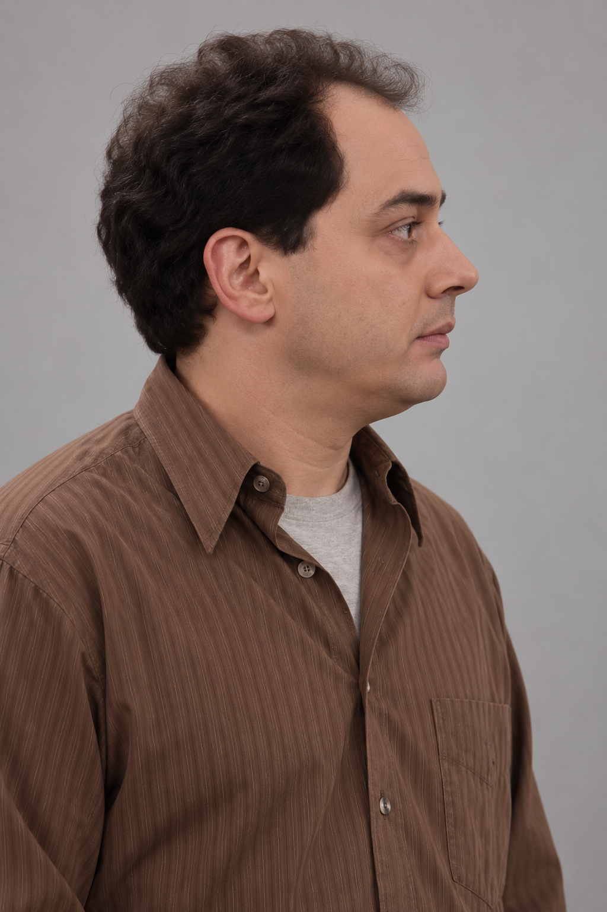</a>

## Carbonell

<a href="carbonell/carbonell-perfil-ulleres-sol.png">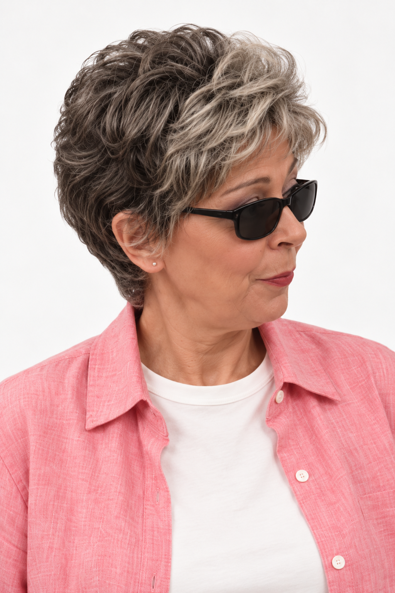</a>
<a href="carbonell/carbonell-retrat-frontal-ulleres-sol.png">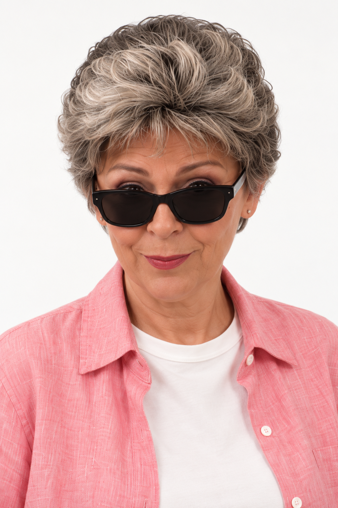</a>

## Emma

<a href="emma/emma-retrat.png">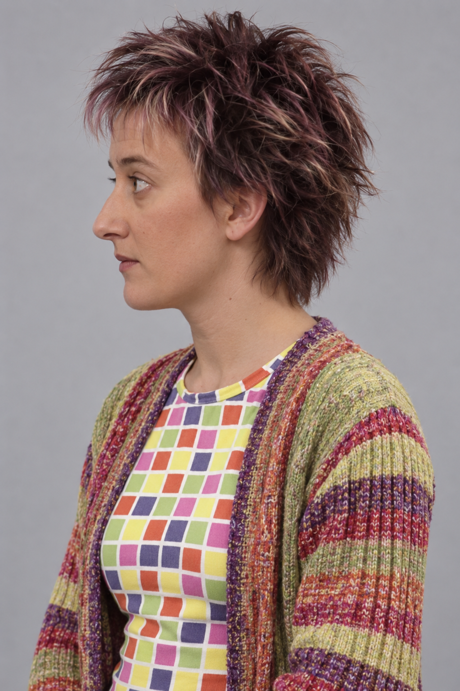</a>

## Ramon

[Torna als projectes](../README.md#projectes)
